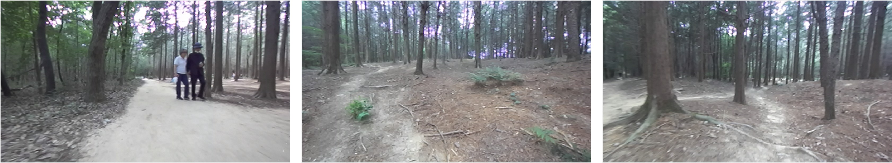
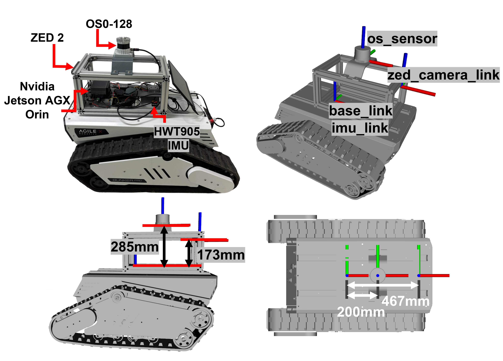

# GEONJI-3D: A Multimodal Dataset for 3D Perception in Unstructured Outdoor Environments

GEONJI-3D is a multimodal dataset collected with a tracked ground robot in the Geonji Mountain Research Forest at Jeonbuk National University. It provides RGB images, registered depth images, LiDAR point clouds, IMU measurements, odometry, and supporting calibration and coordinate-frame information in ROS 2 bags using MCAP storage.

The dataset accompanies our ICCAS 2026 paper and supports research on sensor fusion, terrain perception, and traversability estimation.

The two recordings, `scenario_1` and `scenario_2`, correspond to Scenarios 1 and 2 in the paper.



*Example scenes from GEONJI-3D: walking trails, rough forest paths, trees, and vegetation.*

## Environment and format

- Ubuntu 22.04
- ROS 2 Humble
- ROS 2 bag storage: MCAP (`mcap`)
- Message serialization: CDR (`cdr`)
- Raw data timestamped and recorded using ROS 2 system time

The modalities are recorded together with timestamps for temporal alignment. Their different publication rates and message counts should be taken into account when pairing measurements across sensors.

## Platform and sensors



*Robot platform and sensor configuration, including coordinate frames and mounting dimensions.*

| Component | Model | Nominal rate | Main specification |
|---|---|---:|---|
| Tracked mobile robot | AgileX BUNKER Pro 2.0 | 50 Hz odometry | Ground robot platform for rough terrain |
| Stereo RGB-D camera | Stereolabs ZED 2 | 15 Hz | 110° (H) × 70° (V) × 120° (D) FoV; 0.3–20 m depth range |
| 3D LiDAR | Ouster OS0-128 | 10 Hz | 128 channels; 90° vertical FoV |
| External IMU | WitMotion HWT905-TTL | 200 Hz | 9-DoF accelerometer, gyroscope, and magnetometer |

Sensor data were received and processed on an embedded PC. In addition to the external IMU, the bags contain the internal IMU streams from the Ouster and ZED sensors.

## Scenarios and download

| Item | Scenario 1 | Scenario 2 |
|---|---|---|
| Environment | Relatively wide and flat forest walking trail | Rougher forest paths with irregular terrain, fallen branches, dense vegetation, and sections revisited during the run |
| Download | [Download](https://www.dropbox.com/scl/fo/lco6h4czog9o71660zoib/ADdh9Dh_zdhfSwntkvaGJwU?rlkey=kkg6x9bfwsqy8h5scgp3ike0k&st=b7p4mq45&dl=0) | [Download](https://www.dropbox.com/scl/fo/ivkxngnwur0t39pk48cc1/AB3h58EHN3vERQvRFbqNsxY?rlkey=t9127ayq6m9sacqnrbnj3gfku&st=vhm1f6ky&dl=0) |
| Bag directory | `scenario_1` | `scenario_2` |
| MCAP file | `scenario_1.mcap` | `scenario_2.mcap` |
| MCAP size | 61.8 GiB (66,332,734,881 bytes) | 75.1 GiB (80,629,269,131 bytes) |
| Duration | 382.371 s (06:22.371) | 464.832 s (07:44.832) |
| Total messages | 227,359 | 276,370 |
| Recorded topics | 15 | 15 |

Both scenarios contain dynamic obstacles such as pedestrians.

File sizes refer to the MCAP files alone, with 1 GiB = 2³⁰ bytes. Durations and message counts were checked against both `metadata.yaml` and the MCAP summary records.

## Data statistics

| Bag directory | RGB frames | Depth frames | LiDAR point clouds | External IMU samples | Wheel odometry messages |
|---|---:|---:|---:|---:|---:|
| `scenario_1` | 5,720 | 5,716 | 3,823 | 76,428 | 19,130 |
| `scenario_2` | 6,951 | 6,948 | 4,648 | 92,914 | 23,256 |
| **Total** | **12,671** | **12,664** | **8,471** | **169,342** | **42,386** |

Together, the two bags contain 503,729 messages over 847.203 s (14:07.203) of recordings, occupying approximately 136.9 GiB of MCAP storage. The total duration is the sum of the two recordings and excludes the interval between them.

Message counts are the values stored in each bag. The nominal rates describe the sensor configuration; dividing message counts by the full bag duration gives an average recorded rate that can differ from the nominal rate. RGB and depth frame counts also differ, so use message timestamps when associating frames.

## ROS 2 topics

### Main data topics

These are the five main data topics listed in Table 3 of the paper.

| Topic | Message type | Nominal rate | Scenario 1 count | Scenario 2 count |
|---|---|---:|---:|---:|
| `/odom` | `nav_msgs/msg/Odometry` | 50 Hz | 19,130 | 23,256 |
| `/imu` | `sensor_msgs/msg/Imu` | 200 Hz | 76,428 | 92,914 |
| `/ouster/points` | `sensor_msgs/msg/PointCloud2` | 10 Hz | 3,823 | 4,648 |
| `/zed/zed_node/rgb/color/rect/image` | `sensor_msgs/msg/Image` | 15 Hz | 5,720 | 6,951 |
| `/zed/zed_node/depth/depth_registered` | `sensor_msgs/msg/Image` | 15 Hz | 5,716 | 6,948 |

`/odom` contains wheel odometry, `/imu` contains the external WitMotion IMU measurements, and the depth images are registered to the RGB camera frame.

### Supporting topics

| Topic | Message type | Description | Scenario 1 count | Scenario 2 count |
|---|---|---|---:|---:|
| `/ouster/imu` | `sensor_msgs/msg/Imu` | Ouster internal IMU, approximately 100 Hz | 38,255 | 46,501 |
| `/ouster/scan` | `sensor_msgs/msg/LaserScan` | 2D laser scan, approximately 10 Hz | 3,823 | 4,648 |
| `/ouster/metadata` | `std_msgs/msg/String` | Ouster sensor metadata | 1 | 1 |
| `/zed/zed_node/rgb/color/rect/image/camera_info` | `sensor_msgs/msg/CameraInfo` | RGB camera calibration and projection information | 5,723 | 6,954 |
| `/zed/zed_node/depth/depth_registered/camera_info` | `sensor_msgs/msg/CameraInfo` | Registered depth camera information | 5,723 | 6,954 |
| `/zed/zed_node/imu/data` | `sensor_msgs/msg/Imu` | ZED internal IMU, approximately 100 Hz | 38,147 | 46,364 |
| `/zed/zed_node/odom` | `nav_msgs/msg/Odometry` | ZED odometry, approximately 15 Hz | 5,735 | 6,970 |
| `/tf` | `tf2_msgs/msg/TFMessage` | Dynamic coordinate-frame transforms | 19,130 | 23,256 |
| `/tf_static` | `tf2_msgs/msg/TFMessage` | Static coordinate-frame transforms | 4 | 4 |
| `/robot_description` | `std_msgs/msg/String` | Robot description | 1 | 1 |

### Recorded data layout

The following properties were checked in sample messages from both rebuilt bags:

| Stream | Recorded layout | Message frame |
|---|---|---|
| RGB image | 1280 × 720, `bgra8` | `zed_left_camera_frame_optical` |
| Registered depth image | 1280 × 720, `32FC1` | `zed_left_camera_frame_optical` |
| LiDAR point cloud | Organized cloud, 1024 × 128 points | `os_lidar` |
| External IMU | `sensor_msgs/msg/Imu` | `base_link` |

The LiDAR point fields are `x`, `y`, `z`, `intensity`, `t`, `reflectivity`, `ring`, `ambient`, and `range`. The RGB topic stores four-channel BGRA images; account for the encoding when converting them for image-processing tools.

## Calibration and coordinate frames

Camera–IMU and LiDAR–IMU calibration used Kalibr and iKalibr, respectively; see Section 3.2 of the paper. Each bag includes:

- Camera intrinsics in the RGB and depth `CameraInfo` topics.
- Sensor extrinsics in `/tf_static`, linking `base_link` to the camera optical frame (`zed_left_camera_frame_optical`) and LiDAR frame (`os_lidar`) through the full TF chains.

Use the recorded calibration values for these bags. They contain small differences from the paper: camera `fx = fy ≈ 528.36 px` (paper: `527.62 px`) and LiDAR-to-IMU translation `z ≈ 0.3467 m` (paper: `0.3465 m`).

## Usage

Each bag directory must contain its MCAP file and `metadata.yaml`:

```text
scenario_1/
├── metadata.yaml
└── scenario_1.mcap

scenario_2/
├── metadata.yaml
└── scenario_2.mcap
```

Run the following from the directory containing the downloaded scenario folders:

```bash
source /opt/ros/humble/setup.bash

# Inspect a recording.
ros2 bag info scenario_1

# Replay Scenario 1.
ros2 bag play scenario_1

# Replay Scenario 2 instead.
ros2 bag play scenario_2
```

If ROS 2 reports that the `mcap` storage plugin is unavailable, install it:

```bash
sudo apt install ros-humble-rosbag2-storage-mcap
```

For processing nodes that use ROS simulation time, publish `/clock` during replay and enable `use_sim_time` on those nodes:

```bash
ros2 bag play scenario_1 --clock
```

## Representative uses

Section 3.4 of the paper demonstrates:

- LiDAR–inertial localization and mapping using FAST-LIO2.
- Ground/non-ground segmentation using Patchwork++.
- LiDAR-to-RGB projection using the calibrated extrinsics, including projection of ground/non-ground segmentation results.

These examples demonstrate practical usability. The dataset provides raw sensor recordings; it does not include semantic annotations or quantitative task benchmarks.

## Citation

If you use GEONJI-3D in your research, please cite:

```bibtex
@inproceedings{shin2026geonji3d,
  title     = {{GEONJI-3D}: A Multimodal Dataset for {3D} Perception in Unstructured Outdoor Environments},
  author    = {Shin, Jaeho and Ha, Jiwon and Hwang, Junhyeon and Park, Jaebyung},
  booktitle = {2026 26th International Conference on Control, Automation and Systems (ICCAS)},
  pages     = {2831--2835},
  year      = {2026}
}
```
